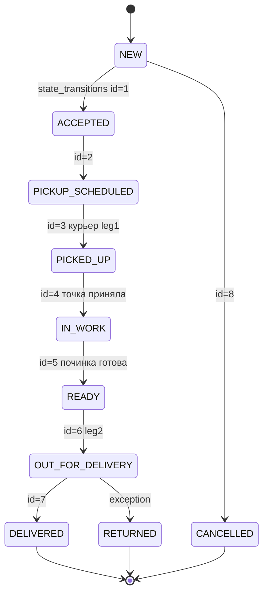
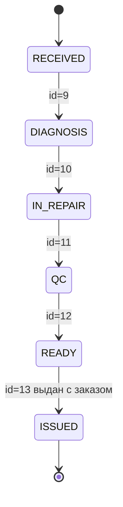

# State Machine — Shveya

## ORDER — 8 шагов NEW → DELIVERED (из 10 ENUM с CANCELLED/RETURNED)

Таблица `state_transitions` 13 записей: 8 для ORDER + 5 для GARMENT.

### Правила
- Переход только если запись в state_transitions is_allowed=true
- Каждый переход пишет в `transfer_history` (transfer_type=STATUS_CHANGE) и `event_log`
- Проверка в триггере или в коде: `EXISTS (SELECT 1 FROM state_transitions WHERE from_status=OLD.status AND to_status=NEW.status AND entity='ORDER')`

## GARMENT — 5 шагов

## Связь с leg_number

- leg_number=1 : NEW → PICKED_UP (забор у клиента)
- leg_number=2 : READY → DELIVERED (доставка клиенту)

CHECK leg_number IN (1,2) + UNIQUE(order_id, leg_number) гарантирует ровно 2 плеча.

## Courier exceptions 14

При leg статусе FAILED — создается запись в courier_exceptions коду OTHER/CLIENT_NO_SHOW и т.д., is_retryable определяет повтор.

## Idempotency

- orders.idempotency_key UNIQUE — защита от дубля заказа
- payments.idempotency_key UNIQUE
- event_log.idempotency_key UNIQUE — защита от дубля события
